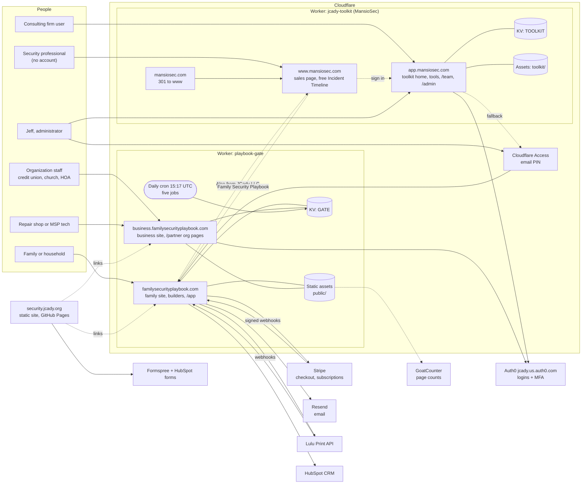
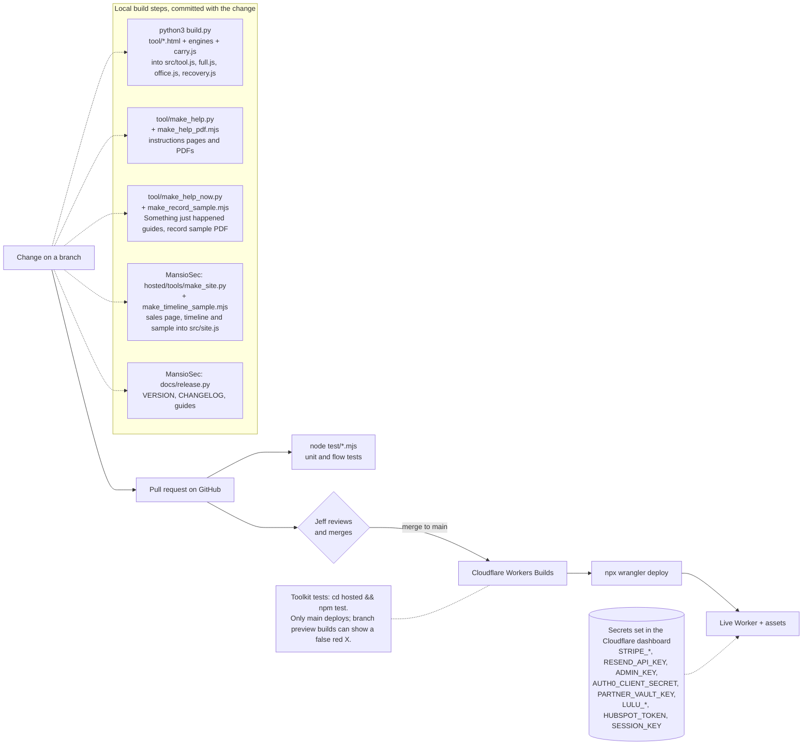
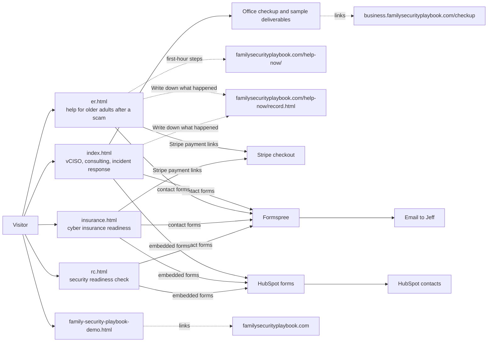

# security.jcady.org: architecture

UML diagrams for this site, with the overview of every JCady system.

Generated from docs/uml/diagrams.py in the familysecurityplaybook repository by docs/uml/make.py. Edit the source there, then regenerate.

## Overview

### System context and deployment

*Activity / component diagram.* Every deployed system, who uses it, and the outside services each one calls. Two Cloudflare Workers (five addresses) and one static site.

### Build and deploy pipeline

*Activity / component diagram.* How a change reaches production. Nothing is pushed to main directly: every change is a pull request that Jeff merges.

## security.jcady.org

### security.jcady.org

*Activity / component diagram.* A static site with no sign-in. Forms go to Formspree and HubSpot; nothing is processed on JCady's own servers.

